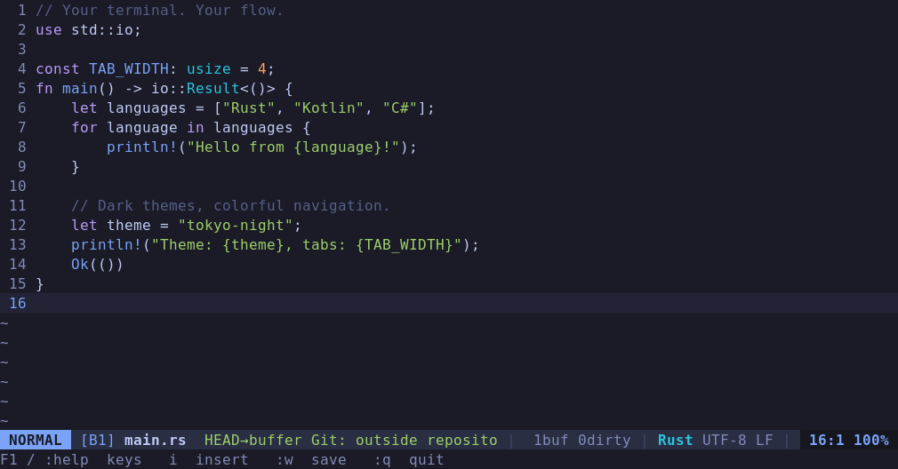
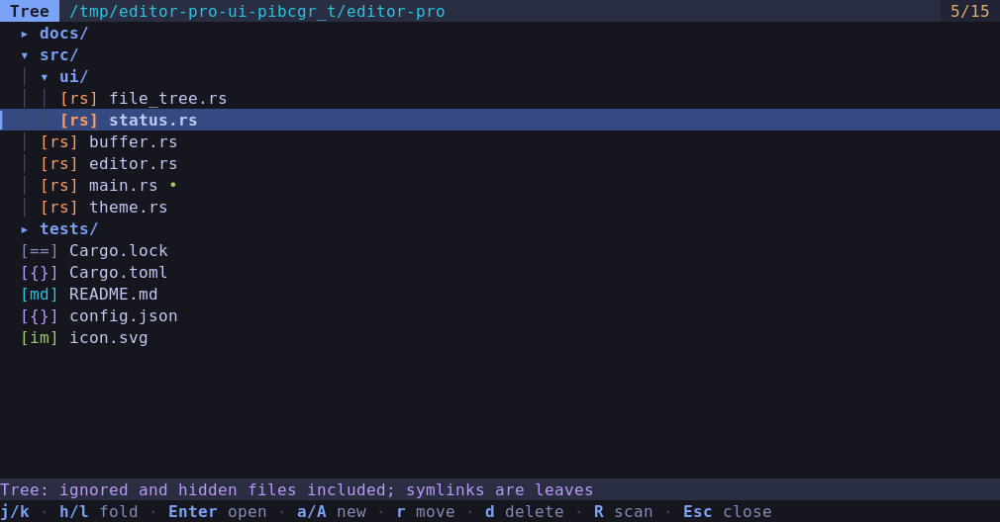

# editor-pro

A terminal-native, Vim-inspired code editor in Rust. **Milestones 1–4 are implemented:**
incremental highlighting for eight languages, Visual selections, composable
motions/operators, search, multiple buffers, fuzzy file navigation, and three
dark themes, plus asynchronous Git status, source gutters, changed-file navigation,
and inline/paired diffs, persistent content-based review marks, notes and Markdown feedback export.
The **M5 language client is implemented and tested on Linux** against pinned
Kotlin/JDT/Roslyn servers on six Maven, Gradle and .NET project fixtures. Editing
and file safety remain independent of terminal rendering.
**M6 code comprehension** adds a symbol outline, workspace symbols and call
hierarchy when supported, asynchronous ripgrep project search, recent files,
and backward/forward source navigation.
**M7 review snapshots** add immutable checkpoints, full/since-review comparisons,
live disk revision detection and conservative note reattachment.
**M8 AI comprehension** adds optional Codex CLI context previews, conversations,
cited navigation, persistent history and explicitly approved, undoable revisions.

**Validation:** 270 Rust tests (including 18 AI, 14 snapshot and 56 LSP regressions),
14 Python tests, formatting, Clippy and the debug build pass on Linux.
The terminal harness covers 29 sessions, including installed `ep` directory/file
startup, configuration, AI revisions/undo/resume, snapshots/live revisions,
project search, history, symbols/calls, LSP edits, automatic completion and installation controls.
Automatic installation passed real Kotlin, Java and C# server fixtures on Linux.
An opt-in fixture also passed against actual Codex CLI 0.162.1 and its provider.
M6 passed three extended real-server fixtures; M5's six-fixture acceptance and
independent Kotlin feasibility probe remain recorded separately. See
[VALIDATION.md](VALIDATION.md) for build results, earlier performance measurements
and exact scope. Native real-server installation on macOS, a minimum-Rust build,
physical-terminal comfort and larger or mixed-language projects remain separate
validation limits.

## Build and run

Use stable Rust with Cargo, rustfmt, and Clippy (Rust 1.88 or newer), and an
interactive terminal on Linux or macOS. A truecolor terminal shows the intended
palettes.
Install `rg` (ripgrep) on PATH for project search and its integration tests;
editing and language commands do not require it.

```sh
sh tools/install-dev.sh
export PATH="${CARGO_INSTALL_ROOT:-${CARGO_HOME:-$HOME/.cargo}}/bin:$PATH"
ep .
ep src/main.rs Cargo.toml
ep --version

# Or build and run directly:
cargo build --locked --release
./target/release/editor-pro src/main.rs Cargo.toml
# Or, during development:
cargo run --locked -- src/main.rs
```

Omit paths to see the themed ASCII-art welcome screen over an empty unnamed
buffer. Start immediately with `i` to edit, `Ctrl-p` to find a file, `F1` for
keyboard help, or `:q` to quit; the first key takes effect as usual. Escape
dismisses the splash, and small terminals show a compact version. File and
directory arguments open directly without the splash.

A nonexistent file in an existing directory opens empty. Multiple paths open
separate buffers; the first is active.
Pass one directory (`ep .` or `ep path/to/project`) to open its file picker and
use it as the session's working directory. Directories cannot be mixed with file
arguments. `--help`, `--version`, and `--config-path` work without a TTY.
Use `ep -- -filename` for a name beginning with `-`.

Plain `cargo install --path .` is also supported (`--path ..` from a direct child
directory). It installs the single `editor-pro` binary. The helper adds `ep` as
a symlink, installs in your Cargo user directory, and can be rerun for updates
without administrator privileges. It leaves user configuration alone.

Apple Silicon Mac users can install with `brew install perrness/tap/editor-pro`
and update with `brew update` followed by `brew upgrade editor-pro`. Releases
contain versioned ARM64 binaries for macOS 14+. Linux binaries are planned;
source builds are available today.
The editor has no self-updater. See [installation and release setup](docs/RELEASING.md)
for the tap bootstrap, automated formula updates and manual binary installation.

## User configuration

`ep --config-path` prints the optional settings file location. On macOS it is
`~/Library/Application Support/editor-pro/config.json`; on Linux it is
`$XDG_CONFIG_HOME/editor-pro/config.json`, falling back to
`~/.config/editor-pro/config.json`. Create it to choose a startup theme and relative line numbers:

```json
{
  "theme": "gruvbox",
  "editor": { "relative_line_numbers": true },
  "lsp": { "auto_install": true, "warmup": true }
}
```

Themes are `tokyo-night` (default), `catppuccin`, and `gruvbox`. Missing settings
use defaults; invalid settings report an error before terminal setup. `:theme`
affects the current session. Line numbers are absolute by default. With
`editor.relative_line_numbers` enabled, the cursor line keeps its absolute number
and other source lines show their distance from it, updating as you move or scroll.
The setting applies to source editing; diff panes retain their old/new coordinates.
Use JSON booleans (`true`/`false`), and correct the reported file and line/column
if settings fail to load. Installation and upgrades never write this file,
and settings are kept outside application binaries and project checkouts.
Missing language servers are installed automatically by default. Set
`"lsp": { "auto_install": false }` for manual/offline operation; existing servers
still start normally, and `:LspInstall` remains available.

## Editing

Press **F1** in any mode or view, or enter **`:help [QUERY]`**, for searchable,
categorized keyboard help. Type words to filter keys, descriptions and contexts;
search ignores case. Try `:help definition`, `:help git diff`, or `:help Codex`.
Use arrows or Ctrl-n/Ctrl-p to scroll, Page Up/Down for pages, Home/End for the
first/last line, and Tab/Shift-Tab to cycle categories. Backspace removes a
grapheme; Ctrl-u clears the query. Long commands wrap in narrow terminals.

**Escape** (also F1, Ctrl-[ or Ctrl-c) returns to the original cursor, viewport,
mode and selection. Help is read-only: Enter does not run the displayed command,
and pasted text does not edit the source. F1 also preserves unfinished prompts,
operators and Insert undo groups. Background workers continue running; their
results are applied after help closes. `:ai help` and `:review help` open the same
reference filtered to those topics.

| Mode | Keys | Action |
| --- | --- | --- |
| Normal/Visual | `h j k l`, arrows | Move by grapheme or line |
| Normal/Visual | `w b e`, `W B E` | Next/previous word and word end; capitals use whitespace-delimited WORDs |
| Normal/Visual | `0`, `^`, `$`, `gg`, `G` | Line start, first nonblank, end, first/last line; `12G` goes to line 12 |
| Normal/Visual | `fX`, `FX`, `tX`, `TX` | Find/till character X on this line, forward/backward |
| Normal/Visual | `;`, `,`, `%` | Repeat/reverse character find; matching bracket |
| Normal | `Ctrl-u`, `Ctrl-d`, Page Up/Down | Move half a screen |
| Normal | `gd`, `gr` | Go to definition or references; jump to one location or choose among multiple results |
| Normal | `i a I A`, `o O` | Insert before/after, first nonblank/end; open line below/above |
| Normal | `d`, `c`, `y` + motion/object | Delete, change, yank; counts multiply (`2d3w`) |
| Normal | `dd cc yy`, `D C Y` | Line operations; D/C through line end, Y yanks lines |
| Normal | `x`, Delete, `s` | Delete graphemes; s deletes and enters Insert |
| Normal | `p`, `P` | Put the unnamed register after/before cursor or line |
| Normal | `v`, `V` | Start characterwise/linewise Visual selection |
| Visual | Motions, `o`, `d c y` | Extend selection, swap anchor, operate on selection |
| Normal | `u`, `Ctrl-r` | Undo/redo; counts are supported |
| Insert | Text, Enter, Tab | Insert text, automatically indented newline, literal tab |
| Insert | Backspace, Delete; arrows, Home, End | Delete/join lines; move and start a new undo group |
| Editing/prompt | Escape, `Ctrl-[`, `Ctrl-c` | Cancel pending input or leave the current mode |

Basic text objects work after an operator or in Visual mode: `iw`/`aw`, `iW`/`aW`,
`i"`/`a"`, `i'`/`a'`, backtick quotes, and inner/around `()`, `[]`, `{}` pairs
(`ib`/`ab`, `iB`/`aB` are aliases). For example, `ciw` replaces a word and `di{`
deletes inside braces. Pair objects support nesting and multiline content; quote
objects are line-local and recognize escapes. Pair matching is lexical, so
brackets inside strings/comments can affect it.

In Insert mode, typing `(`, `[`, `{`, a double/single quote, or a backtick adds
its closing delimiter and leaves the cursor between the pair. Typing the matching
closer already under the cursor advances over it; Backspace between an empty pair
removes both. Pairing applies at line ends, before whitespace, closing delimiters,
commas, semicolons and colons. New quote pairs are suppressed after a word;
quotes after an odd number of backslashes are literal. These are lexical rules,
independent of language syntax; angle brackets remain literal. Paste, registers,
command prompts and search stay literal.

An Insert session or change plus replacement is one undo step; movement and
bracketed paste create separate groups. History retains up to 1,000 groups per
buffer. Bracketed paste is accepted only in Insert and cannot execute commands.
Registers are shared across buffers and pasted line endings adapt to the target.
Tabs display at four-cell stops. **Enter**, **o** and **O** inherit the current
line's spaces/tabs. For Rust, Java, Kotlin, C#, JSON, YAML and TOML, opening
delimiters add one indentation level; YAML mapping colons do too. Enter between
paired delimiters leaves an indented blank line with the closing delimiter on
the following line. `O` above a closing delimiter opens an indented line inside
the block. Delimiters in strings/comments do not trigger block indentation.

The indentation unit is inferred from up to 200 nearby lines, preserving tabs
and existing space widths. With no evidence, code uses four spaces and
JSON/YAML/TOML use two. Plain text, Markdown and files without available syntax
inherit whitespace only. Indentation uses local text and language defaults;
framework settings and `.editorconfig` are not read. Tab inserts a literal tab;
bracketed paste and register puts keep their supplied indentation.

## Search and navigation

Use `/text` or `?text`, then Enter, to search forward/backward. `n` repeats in
that direction, `N` reverses it, and counts such as `3n` work. Results wrap.
Search is literal, case-sensitive, single-line and non-overlapping; it never
lands inside a grapheme. Escape cancels without moving or replacing the previous
query. Search can extend a Visual selection. `:noh` hides matches until the next
search navigation. At most 100,000 matches are retained, with truncation reported.

`Ctrl-p` or `:files` opens a fuzzy picker rooted at the process working directory;
`:files path/to/project` chooses another root. Type to filter; arrows or
`Ctrl-n`/`Ctrl-p` select, Enter opens, and Escape returns to the source. Discovery
and Nucleo matching run in workers. The picker respects ignore files, includes
non-ignored hidden files, excludes VCS metadata and symlinks, and reports scan
errors or its 100,000-file limit. Matching uses Nucleo's smart case/normalization.

`:ls` opens the buffer list; use `j`/`k` or arrows, Enter to switch, Escape to
return. Switching preserves unsaved text, undo history, cursor and viewport.

## Code comprehension and project navigation

| Command/key | Action |
| --- | --- |
| `:Outline` or `:Symbols` | Hierarchical document symbol outline; Enter jumps |
| `:WorkspaceSymbols [QUERY]` | Search symbols in the active file's language-server project; Enter resolves a lazy location if needed, then opens it |
| `:Calls` | Prepare call hierarchy at the cursor; select a symbol, then `i` for incoming or `o` for outgoing calls |
| `:grep TEXT` | Search project files on disk for literal, case-sensitive text |
| `:grepdir DIRECTORY` | Set the root for subsequent searches; `:grepdir` resets automatic discovery |
| `:recent` | List up to 100 recently visited paths in this session |
| `Ctrl-o`, `:back` | Return to an earlier source buffer, cursor and viewport |
| `Ctrl-i` (Tab), `:forward` | Return to the later location; a new jump clears forward history |

Symbol and call lists use the existing LSP view. Unsupported capabilities are
reported explicitly. In a call hierarchy, `i`/`o` follow the selected symbol
recursively, Backspace restores the parent list and its selection, Enter opens
the symbol's declaration, and Escape returns to the unchanged source. Details
show call-site coordinates in the caller (one-based UTF-16 columns). Lists cap
at 4,096 rows and 16 parent levels. Workspace queries use one active root/language,
not an aggregation of all servers. Escape also cancels a pending source request.

Project search runs ripgrep in a cancellable worker. It respects ignore files,
includes non-ignored hidden files, and excludes VCS metadata and symlinks.
The root is an explicit `:grepdir`, the current LSP project, or the nearest
Cargo/Git boundary; language-specific build discovery applies to Kotlin/Java/C#
even before their server is ready. Without a boundary it uses the file's parent,
or the working directory for an unnamed buffer. The result heading shows the root.
Use `j/k`, arrows or Page Up/Down to select, `h/l` to scroll, Enter to open,
`r` to repeat the query, `:grep TEXT` to replace it, and Escape to cancel/return.

Results describe **disk text**, with one-based line and UTF-8 byte columns;
opening converts to the editor's grapheme cursor. An open dirty buffer is reused,
and a result whose matching line differs from current text is refused. Search
never reloads or saves buffers. It scans files up to 2 MiB, retains at most 4,096
matches, bounds captured output to 16 MiB, and has a cooperative ten-second
deadline. Limits and skipped non-UTF-8 result lines are visible. Binary detection
uses ripgrep's defaults. Queries are single-line literals, not regexes or shell
commands; spaces are literal within the trimmed command argument.

History records file/buffer changes and explicit LSP, diagnostic, Git-source and
project-result jumps, including same-file jumps. Normal cursor movement does not
create entries. Both history directions cap at 256 locations. Named closed buffers
can reopen; unavailable entries report an error and are skipped on the next
attempt. Existing buffers retain unsaved edits and independent undo histories.
Locations are stored scalar offsets, clamped after edits/reloads; they do not
track moving symbols. Recent files and history are session-local. Ordinary file
loading remains synchronous under the existing file-size limit.

## Git-aware editing

Git is optional; install Git on PATH to enable inspection. No language server is
needed. This workflow is read-only: it has no staging, committing, checkout or
reset commands. Run the editor from any directory and open a file in a repository;
discovery follows its containing repository, including linked worktrees.

| Command / Normal-mode key | Action |
| --- | --- |
| `:changes`, `Space g c` | List repository disk/index changes and separately labeled unsaved buffers |
| `:diff [HEAD\|index\|REV]`, `Space g d` | Compare that base with the current file's working content; the shortcut keeps the selected base |
| `:diff staged` | Inspect staged changes: HEAD versus index, excluding unsaved edits |
| `:gitbase HEAD\|index\|REV` | Choose the source-gutter and subsequent diff baseline |
| `:gitrefresh` | Request fresh status and comparison data |
| `]c`, `[c` | Jump to the next/previous hunk in the current source buffer |
| `:gnext`, `:gprev`, `]f`, `[f` | Open next/previous changed file, retaining other buffers |
| `:diffclose` | Close a diff and restore its originating source location |

Type the shortcut keys in sequence in **Normal mode**. `Space g` shows the Git
keys; Escape cancels an unfinished sequence. Counts work before bracket shortcuts
(for example, `2]c` or `3[f`). Hunk jumps use the first changed line, skip leading
diff context, and stop at the first/last hunk with a message. File navigation wraps
through the Changes list. `Ctrl-o` returns from a source jump.

Hunks and diffs use the selected HEAD/index/revision base and current unsaved
buffer text. The Changes list still reports repository disk/index status plus
unsaved buffers. Loading or stale data reports a retry message without moving the
source; navigation never waits for Git or queues a later jump. Empty comparisons
and lists report that there are no hunks or changed files.

In **Changes**, `j`/`k` or arrows select; Enter opens source, or a historical diff
for a deleted file; `d` opens a diff; `r` refreshes; Escape returns. `XY` reports
index then disk status (`M`, `A`, `D`, `R`, `?`, or conflict flags; `.` is unchanged).
Renames show both paths. `B<ID>+ UNSAVED` is independent of those Git flags; a
buffer-only row can appear even when Git's disk/index status is clean.

In a **diff**, `j`/`k` or arrows scroll, Page Up/Down or Ctrl-u/d move half a screen,
`g`/`G` go to the first/last row, `[`/`]` navigate hunk headers, and `h`/`l` scroll
horizontally. Tab toggles aligned, synchronized old/new panes. Below 100 columns,
the paired view falls back to inline automatically; selection survives resizing.
`1`, `2`, `3` select HEAD, index, or staged; `:diff REV` selects a commit-ish
(e.g. `HEAD~2` or `refs/heads/main`). `n`/`p` inspect the next/previous changed
file within the diff, and `r` refreshes.

**Escape restores the original buffer, cursor and viewport**, including after
browsing other changed files. Enter instead jumps to the selected current source
line. Deleted-only lines anchor to the following surviving line, clamped to EOF;
a wholly deleted file without an open dirty buffer has no current source, so it
stays inspectable and explains why jumping is unavailable. Staged coordinates
are mapped through working/unsaved changes before jumping. These are contextual,
read-only views, not another editing mode; `:w` in a diff is refused.

Both sides are labeled with paths and resolved commit/blob identities. Working
comparisons use open buffer text, including `UNSAVED` edits; otherwise they read
disk. A clean loaded buffer may differ from externally changed disk and is labeled
as such. If the file was deleted, a clean loaded copy does not hide that deletion;
a dirty copy still participates as unsaved content. Staged comparisons always use
index content on the right. Neither comparison stages or saves anything. Unborn
HEAD is an empty baseline. Untracked files are additions. Empty/mode-only changes
have no text hunks. Missing final newlines and changed CRLF rows are annotated. Binary/non-UTF-8 files,
symlinks/submodules and unresolved conflicts have explicit unsupported responses.

Source gutters use theme colors for `+` added, `~` modified and `-` deleted lines,
including EOF deletions. The statusline shows branch or detached identity and
`S` staged, `W` unstaged, `?` untracked and `!` conflicted file counts. Wider
terminals show more detail. These counts describe disk/index only; `[+]` means an
unsaved buffer. Closing a staged diff returns source gutters to HEAD.

Edits, saves, buffer/base changes and focus gain request asynchronous updates.
Idle polling notices external Git changes about every two seconds. Requests
coalesce after 75 ms of quiet; a single worker cancels superseded subprocesses and
discards obsolete results. Loading/stale/error states are visible; stale gutters
and source jumps are withheld. Refresh never reloads text or changes undo history.
`r` / `:gitrefresh` retries errors. Inspection has a cooperative five-second job
budget, 2 MiB per content side, 16 MiB command output and 100,000-file/diff-row
limits. Heavy/remote repositories may exceed them. Renames follow Git's detection;
untracked moves may appear as deletion plus addition. Submodule interiors are
ignored. Optional Git locks, external diff/textconv, fsmonitor and configured
clean/process filters are disabled. `filters off` warns that filter-dependent
repositories may show raw-content status differences. Snapshots sample Git state;
concurrent external writes can race and are corrected by later polling. Existing
synchronous file loading/saving remain separate; disk monitoring and `:refresh`
comparisons run on a background worker.

## Code review

Review works entirely in the terminal, without LSP or AI. Use `:diff` to inspect
an agent's changes; file/hunk marks and notes never save source or alter the index.

| Command / diff key | Action |
| --- | --- |
| `:review file reviewed`, `F` | Mark the accepted file comparison reviewed |
| `:review hunk reviewed`, `R` | Mark the selected hunk reviewed |
| `:review hunk attention`, `A` | Mark the selected hunk needs-attention |
| `:review file\|hunk unreviewed\|attention\|reviewed\|clear` | Set/change/clear a mark on the current exact content |
| `:review list [all\|stale\|attention\|unreviewed\|notes]` | List stored records, stable IDs, attachment locations and freshness |
| `:review clear ID` | Explicitly remove a stored record, including a stale one |
| `:review revalidate ID file\|hunk` | Explicitly retie a mark to the currently accepted content/selection |
| `:review next\|prev file\|hunk [unreviewed\|attention\|stale\|all]` | Navigate matching targets; default filter is unreviewed |
| `:note file\|hunk\|old\|new` | Create a note on the file, selected hunk, or selected old/new diff line |
| `:notes`, `:note next\|prev` | List or navigate notes |
| `:note edit ID`, `:note remove ID` | Edit text or explicitly remove a note |
| `:note attach ID file\|hunk\|old\|new` | Explicitly correct a note's attachment to current content |
| `:review export /outside/worktree/new.md` | Export loaded progress/notes to a **new** Markdown file |
| `:review reload`, `:review retry`, `:review help` | Reload shared metadata, retry a failed write, or show commands |

In the review list, `j`/`k` select, Enter opens the record's comparison, `e` edits a
note, and Escape returns. Press Enter to inspect before making a mark or adding
a note from this list. File actions also work from source once its comparison
is ready. Open a selected Changes row with `d` before annotating it; hunk and line
actions require a diff. In paired layout, `old` and `new` select that pane's line.
Deleted-only lines support old-side notes; absent sides are refused. Empty files
and mode-only changes support file marks/notes. Renames retain both paths.

Notes temporarily use the **same ordinary Normal/Insert/Visual/Search editing
engine**, with independent note undo. Press `i`, enter Unicode/multiline text (or
bracketed paste), Escape to Normal, then `:note save`. `:note cancel` discards the
draft. Escape in Normal closes an unchanged note; a changed draft requires save
or explicit cancellation. Source text, undo history, register, search, cursor and
viewport are retained. Saving/cancelling returns to the context; Escape from the
diff still restores the original source location, even after cycling files.
While editing a note, source/file commands are guarded. A failed save keeps the
draft; `:note save-new` can preserve a conflicting edit as a separate note.

`F`/`H` counts are **fresh reviewed file/hunk marks**, counted separately. One or
all reviewed hunks never implicitly review a file. `!`/attention counts remain
visible even under a reviewed file mark: those hunks still need attention. `N`
is the number of notes, including unresolved notes. Stale/unavailable records do
not count as reviewed. The unreviewed navigation filter includes missing, stale
or unavailable current marks and fresh needs-attention marks. Attention navigation
also visits historical attention records. Use the stale record list for notes or
hunks that no longer have any current location; they are not silently reattached.

Freshness requires the same worktree root **and absolute Git directory**, comparison
kind/requested base, full resolved commit and blob IDs, old/new paths and modes,
and **SHA-256 of each side's exact bytes with separate presence flags**. This
includes unsaved text, CRLF and final-newline differences; empty and absent files
are different. Timestamps, file size alone, Git status, row numbers, abbreviated
display IDs and approximate navigation anchors never establish freshness. Hunk
and line signatures must be unique within the exact comparison; repeated
signatures are refused with a suggestion to annotate the file. Ordinary Git
comparisons conservatively stale attachments after a containing change. Immutable
review baselines additionally support the content reattachment described below.
Explicit correction can move a record to a selected current location; the original
annotation otherwise remains stored with its historical identity.

Known edits, buffer/base changes and pending refreshes immediately withhold fresh
progress. **Undo back to identical bytes can restore freshness only after a new
accepted comparison validates both sides and resolved identities.** Movement,
scrolling, resizing and layout toggling do not invalidate content. A clean loaded
buffer can still differ from disk: freshness describes the labeled compared
buffer, not an assertion that disk matches it. External changes to unopened paths
are read from disk. Git samples are not atomic against external writers; polling
can only notice changes on subsequent samples.

Refresh validates the current path plus up to **31 other annotated paths** for
the selected comparison, in deterministic path order, sharing Git's five-second
budget and existing content/row limits. Other bases, failed/unsupported comparisons
and excess paths remain unavailable, with a visible validation-limit indication.
Inspect a path to prioritize it. A first load/restart validates actual content;
unsaved annotations are stale or unavailable unless that content really exists
again. Metadata loading, hashing, serialization, persistence and export run in
workers. Review actions are serialized; wait for completion before the next one.

Moving/copying a repository changes its identity; stores are not automatically migrated.
File navigation uses the existing disk/index/unsaved changed-file list; the record
list also keeps annotations on files no longer present in that list.

Progress lives in **`<absolute-git-dir>/editor-pro-review.json`**, outside tracked
files and the index; linked worktrees have separate stores. Inspection alone does
not create it. Version 1 stores fingerprints, marks, note text and at most 512
bytes of context per record. Explicit snapshot creation upgrades the store to
version 2, retaining those records and adding immutable source trees. Limits:
32 MiB per store, 4,096 records and 16 KiB per note. New files are private on Unix.
`Review pending`, `Review saved #ID` and errors report durability. Quit waits for
you to resolve pending actions; a failed mark can be retried, discarded by an
explicit reload, or abandoned with `:q!`. A note draft has its own save/cancel guard.

Writes lock `editor-pro-review.json.lock`, reread the store, compare the expected
record revision/content, merge unrelated records, then sync a temporary file,
atomically replace the store and sync its directory. Concurrent edits to the same
record (including duplicate new marks) fail visibly. Use `:review reload` to see
the winner before choosing a new action. Locks are never stolen; after a crash,
verify the recorded process is gone before manually removing its abandoned lock.
Corrupt, future-version, oversized, symlinked, hard-linked or unwritable stores
are preserved. Arbitrary external writers and filesystem failures can still race
or make durability uncertain; network filesystems are not a supported guarantee.

Export includes **all annotations loaded by this session**, including other bases,
stale/unavailable notes, identities, sides, historical line hints, bounded excerpts
and separate progress counts. Ordering is deterministic. Markdown/HTML punctuation
and controls are escaped; non-UTF-8 path bytes use escaped byte notation. Exports
must be outside the worktree/Git metadata and open source paths, with an existing
parent directory; existing files and symlinks are never overwritten. Export never
saves dirty source, stages files or sends data anywhere. Other instances' new
annotations require `:review reload` before export.

A terminal-only walkthrough (wait for comparison/loading and pending writes):

```text
:changes                         select a changed file, then d
:review hunk attention
:note hunk                       i, write feedback, Escape, :note save
:review file reviewed
:q                               or :q! to discard deliberately unsaved source
# Restart editor-pro with the same file; progress loads and is revalidated.
:diff
:notes                           Enter inspects; e edits; Escape returns
:review list stale               inspect unresolved progress after code changes
:review export /tmp/feedback-1.md use a new path for every export
```

## Review snapshots

Use checkpoints to review successive revisions, including changes written by an
external agent. No AI integration is required, and the editor does not infer who
made a disk change.

| Command | Action |
| --- | --- |
| `:review snapshot` | Capture the worktree's current files and dirty buffers as a new immutable checkpoint |
| `:review full` | Compare the first captured full baseline against current text |
| `:review since [ID]` | Compare a checkpoint against current text; defaults to the latest checkpoint |
| `:review snapshots` | Show the retained checkpoint range and latest file count |

The **first** checkpoint also captures your selected HEAD, index or revision as
an immutable full baseline. Start from `:gitbase HEAD`, `:gitbase index`, or
`:gitbase REV`; a first checkpoint from a staged comparison is refused. Later
checkpoints append current trees and preserve the original full baseline. Creating
a checkpoint records a review boundary; it does not mark files or hunks reviewed.
After finishing a revision, capture again, then use `:review since` to see only
subsequent changes. `:review since ID` pins that comparison until you select another
checkpoint, even if a later checkpoint is created. `:review full` always uses the
original baseline, including after commits or branch movement.

Capture includes tracked files, non-ignored untracked files, previously captured
paths, and named dirty buffers in the worktree. Dirty buffers supply their exact
request-time text; other files are read from disk. Binary and non-UTF-8 assets are
retained too, with exact bytes and content hashes. All source bytes, presence,
Unix executable modes and raw filenames are retained. Capture never saves source,
changes HEAD or writes the index. Disk is sampled twice and a changing sample is
refused. This is **not an atomic filesystem snapshot**; writes can still occur
between observations. Capture runs in the review worker with a cooperative
30-second deadline. Wait for `Review snapshot #ID saved`; a failed capture leaves
previous checkpoints intact. Use `:review reload` after an error or another
instance advances the checkpoint, then capture again.

The existing diff view, paired layout, hunk navigation, `n`/`p` and `:changes` work
with either review comparison. The changed-file list labels its entries as
**snapshot deltas**, including committed changes, additions, deletions and mode
changes. Git-reported renames and unique nonempty exact-content moves are matched;
ambiguous moves remain additions/deletions. Binary assets participate in these
deltas; selecting one reports that a text diff is unavailable. Text review in
the rest of the repository stays available. Refresh polls every two seconds and on
focus/`r`/`:gitrefresh`. It hashes disk bytes, including files hidden by dirty
buffers, and reports `disk revised` when a later sample differs. `disk differs`
means disk and an open buffer disagree; unsaved edits can also cause this label.

**Open documents are never reloaded automatically.** A clean open document can
retain earlier bytes while review displays current disk text. Enter maps the
review location back into that retained source; the mapping is approximate after
substantial changes. Source gutters are withheld when the clean source differs
from the compared disk. Dirty buffers remain the compared text; external disk
revisions remain visible in status and ordinary save-conflict protection still
applies. Escape preserves source cursor, viewport and undo. Use `:e!` only when
you explicitly want to reload.

In a fixed review baseline, unchanged **unique hunk/line signatures** can stay
fresh and follow moved line numbers or a recognized rename. Both sides' modes,
the complete old content and baseline identity must still match. Changed file
marks/notes become stale; changed or repeated attachment signatures never regain
fresh progress. Existing annotations for the captured original comparison can
also be validated in the full view. Other bases stay separate. Reattachment is
derived during refresh: stored identities, notes and historical coordinates are
not rewritten. Explicit `:note attach` / `:review revalidate` remain available.

Limits are **512 paths** across current and retained trees, **2 MiB per file**,
**8 MiB per tree**, **32 checkpoints**, **24 MiB of retained file bytes**, and
**32 MiB of serialized metadata**. Binary bytes count toward the same limits and
use two hexadecimal characters per byte in metadata. Symlinks, submodules,
conflicts and exceeded limits fail visibly; no partial checkpoint is saved.
There is one baseline per worktree store, with no automatic pruning/reset. Full snapshot
trees are stored privately in Git metadata and omitted from Markdown feedback
exports; ordinary annotation excerpts remain included. Existing text snapshots
remain readable; older editors that lack binary support refuse stores containing
binary payloads. Older version-1 editors refuse all version-2 stores. Snapshot
writes reuse the annotation lock and atomic persistence; competing checkpoints
conflict while unrelated annotation changes merge. Validation still covers the
current path plus up to 31 other annotated paths within Git's five-second budget.

## Language intelligence

Launching `editor-pro .`, another directory, or with no arguments prepares likely
Java, Kotlin and C# servers in the background after the first terminal frame.
Discovery checks the repository/build root and at most two levels of child
projects, using Gradle/Maven/solution markers and source-layout hints. Kotlin DSL
build scripts alone do not select Kotlin. At most two likely sessions are warmed;
broader polyglot projects, ambiguous solutions and unrecognized layouts keep lazy
startup. Set `"lsp": { "warmup": false }` to disable preparation independently of
automatic installation. Explicit file arguments retain normal lazy startup.

Opening a matching source reuses the prepared session and synchronizes its current
unsaved text. Root/argv overrides, installation policy and runtime requirements
still apply. Unused warm sessions yield to opened files at the eight-session limit.
Startup/import status appears in the statusline and `:LspInfo`; preparation does
not send notifications or open hidden documents. Server import and indexing can
continue after initialization, and some servers defer work until a document opens.
Preparation moves work earlier; it does not guarantee instant code intelligence.

Language servers are optional. Opening a named Kotlin (`.kt`/`.kts`), Java
(`.java`) or C# (`.cs`) buffer starts background discovery. Default commands are
`intellij-server --stdio` (official JetBrains Kotlin), `jdtls` (Eclipse JDT LS)
and `csharp-ls` (Roslyn-based). Explicit command overrides take precedence, followed
by executable servers on PATH and editor-managed installations. If a server is
absent, the editor downloads and installs its pinned distribution in the background,
then starts it with the latest unsaved buffers. Failed explicit overrides and
incompatible runtimes remain visible errors. Editing continues during installation.

Managed installations support macOS on ARM64 and glibc Linux on x86_64 and ARM64.
Kotlin **263.6379.0** includes its Java 25 runtime. JDT LS **1.60.0-202606262232**
needs an installed **JDK 21+** selected by JAVA_HOME/PATH; `csharp-ls` **0.28.0**
needs an installed **.NET SDK 10+** on PATH. The editor checks runtime versions,
but does not install JDKs, .NET SDKs or project toolchains. Its managed JDT launch
uses Java directly, without requiring the upstream Python launcher.

Servers live under `$XDG_DATA_HOME/editor-pro/lsp` (absolute paths only, otherwise
`~/.local/share/editor-pro/lsp`) on Linux, or
`~/Library/Application Support/editor-pro/lsp` on macOS. No PATH or shell-profile
changes are needed. The installer verifies pinned SHA-256 hashes, extracts into
private temporary directories and publishes complete versioned installations.
Concurrent projects/editors share an installation lock. Completed installs work
offline; failed or cancelled installs require `:LspInstall` to retry. A killed
editor's temporary install is cleaned on the next attempt. Existing installations
are reused; the installer does not query a moving “latest” release.

`:LspInfo` displays download/extraction progress and errors, and `:Doctor` shows
the selected server source, command and runtime. `:LspInstall` installs the current
file's server; specify a language to install from an unnamed/unsupported buffer.
`:LspInstallCancel [LANGUAGE]` cancels that language's shared installation, including
other projects waiting for it. Cancellation and shutdown can wait up to ten seconds
for an idle network read. Downloads have a ten-minute budget and 1 GiB cap;
tar/ZIP extraction caps at 100,000 entries and 4 GiB expanded. Filesystem stalls are not
hard-time bounded. Proxy environment settings are honored; HTTPS certificate
verification uses the HTTP client's bundled public roots.

A server's project import may invoke build tools and fetch dependencies. The
runtime SDK and project's target SDK can differ; see the
[server report](docs/LANGUAGE_SERVERS.md). Other highlighted languages, including
Rust, do not yet have LSP integration or automatic installers.

The statusline links to `:LspInfo` and distinguishes these states:

| State | Meaning and next step |
| --- | --- |
| Starting | Discovering/probing the executable, waiting for initialization, or retrying a stopped process. Elapsed seconds remain visible while you edit. |
| Indexing | The server reports active import/index tasks. `:LspInfo` lists concurrent tasks and retains their titles across updates. Finishing one task does not finish another. |
| Ready | Initialization completed and no reported work remains. This is protocol readiness; a server can continue unreported indexing or start more work when a file opens. |
| Degraded | The server reported an error or warning, such as a missing project SDK or failed Gradle/Maven import. The reason stays visible through later progress updates; inspect it before relying on language results. |
| Failed | Discovery/runtime/launch failed, or a stopped session exhausted its automatic retries. Editing remains available. |

`:LspInfo` shows elapsed time for Starting/Indexing, active tasks and any percentage
**supplied by the server**; it never estimates project completion. After 30 seconds
it also reminds you to inspect import logs and project SDKs. Initialization has a
180-second deadline; indexing after initialization has no guessed completion
deadline. `:LspLog` updates live with bounded recent stderr/messages. Both views
link to `:Doctor`, and F1 or `:help LSP` explains these commands.

For a missing executable, use `:Doctor` and `:LspInstall kotlin` / `:LspInstall java`.
For a missing runtime, JDT LS needs JDK 21+ selected by `JAVA_HOME`/`PATH`; the
managed Kotlin server bundles its own runtime. The project's Gradle/Maven JDK or
SDK is separate and may still be missing. For import failures, inspect the exact
server message in `:LspInfo`/`:LspLog`, check the project root in `:Doctor`, and run
the project's normal Gradle/Maven build to diagnose toolchains, dependency
repositories, authentication/proxies or invalid build files. After fixing the
cause, use `:LspRestart`; changes to the editor's inherited environment require
relaunching it from the corrected shell. Restart reopens current unsaved text.
Reported warnings remain Degraded until restart, even if another task completes.
Crashes retry at most twice per session; edits never trigger a new retry cycle.
Stopping/restarting invalidates that session's diagnostics and pending results.

Use `:Doctor` for actual executable/root/SDK discovery and runtime version output,
`:LspInfo` for negotiated features and import status, and `:LspLog` for recent
stderr/messages. Missing prerequisites and unsupported features produce useful
errors; editing, Git and review continue working.

Server overrides are argv arrays, with no shell expansion:

```sh
EDITOR_PRO_KOTLIN_LSP='["/path/to/kotlin/bin/intellij-server","--stdio"]' \
  cargo run --locked -- /path/to/project/src/Main.kt
```

The corresponding variables are `EDITOR_PRO_JAVA_LSP` and
`EDITOR_PRO_CSHARP_LSP`. A single executable path is also accepted. Wrappers may
select SDKs or pass server-specific initialization arguments. JDT LS gets a
private temporary `-data` directory; omit that argument from overrides.

Discovery chooses a containing Gradle settings file, the nearest Maven POM,
or a containing C# solution/project, stopping at a Git boundary; otherwise it
uses the source directory. Multiple solutions are an explicit ambiguity.
`EDITOR_PRO_LSP_ROOT=/absolute/project` overrides discovery; configure the
server argv to select the intended solution when necessary. Sources outside
that override are refused. `:LspRestart` rediscovers and reopens unsaved documents.

| Command / key | Action |
| --- | --- |
| Insert typing | Show completion suggestions beside the cursor after a short pause |
| Popup arrows / `Ctrl-n` / `Ctrl-p` | Select a suggestion; Tab or Enter accepts; Esc or `Ctrl-e` dismisses |
| `:Complete`, Insert `Ctrl-n` | Request a completion list; `d` resolves documentation, Enter or Tab accepts |
| `:Hover` | Read documentation at the cursor |
| `:Signature` | Show signatures and the active parameter |
| Normal `gd`, `gr` | Request definitions or references at the cursor; jump directly to a single location, or choose from multiple results |
| `:Definition`, `:References` | List locations; Enter opens source, including read-only C# generated/decompiled documents |
| `:Diagnostics` | List current diagnostics across open sources; Enter jumps |
| `:Dnext`, `:Dprev` | Navigate diagnostics in the current buffer, wrapping |
| `:Rename NEW_NAME` | Propose a symbol rename, including edits to other files |
| `:CodeAction` | List fixes/actions; Enter selects, resolving edits when supported |
| `:Format` | Propose document formatting |
| `:Symbols`, `:Outline` | List document symbols, including nested symbols |
| `:WorkspaceSymbols [QUERY]`, `:Calls` | Project symbols and call hierarchy; see code comprehension above |
| `:LspInfo`, `:LspLog`, `:Doctor` | Inspect capabilities, logs, roots and SDK/server discovery |
| `:LspInstall [kotlin\|java\|csharp]` | Install a missing server, or retry a failed/cancelled installation |
| `:LspInstallCancel [LANGUAGE]` | Cancel the current/specified language's installation |
| `:LspRestart` | Restart the current root/language session and resynchronize |

Results use a contextual view: `j/k` or arrows select, Page Up/Down scroll,
`h/l` scroll horizontally, and Escape returns without changing source location.
For `gd` and `gr`, Enter opens the selected result when there are multiple
locations; `Ctrl-o` returns after a jump, and `Ctrl-i`/Tab goes forward again.
These shortcuts require a ready language server for the current source file.
Escape cancels a pending request; moving, editing or switching buffers discards
obsolete results. No matches or unavailable targets leave the source in place.
C# enables `csharp-ls` metadata URIs, so `gd` can open classes and members in
compiled assemblies and source-generator output. These buffers show `[RO]`,
support searching, copying, further `gd`/`gr` navigation and history, and cannot
be edited or saved. The editor fetches source from the owning server, preserving
its URI and UTF-16 location; it does not create a temporary project file.
Repeated jumps refresh generated output in the same buffer. After a server
restart, return to project source and jump again to obtain a current snapshot.
Virtual source is limited to 2 MiB per document and 32 open buffers.
The server still needs a successfully imported project and resolved references;
project-reference source generators may need to be built first. Empty definitions
include a hint to check `:LspInfo` and `:LspLog`. Exact overload/constructor
locations depend on the server; some decompiled targets point to the file start.
Documentation is displayed as plain text, including Markdown source.
In Insert mode, typing an identifier or a server-advertised trigger such as `.`
requests suggestions after a 120 ms pause. The popup keeps the source and cursor
visible; continued typing and Backspace refresh it. Tab or Enter accepts the
selected suggestion; arrows or `Ctrl-n`/`Ctrl-p` select, and Escape or `Ctrl-e`
dismisses without leaving Insert. With no popup, Escape leaves Insert as usual.
Cursor movement, paste, buffer switches and newer edits cancel obsolete requests. Suggestions wait for
the server to finish starting; they require a supported, named source file.
With no popup, `Ctrl-n` still opens the explicit completion list. `:Complete`
also remains available. Snippet expansion is unsupported. Selecting a completion
also accepts its advertised server command and the command's guarded text edit.
Only negotiated features can be requested. JDT LS signature help is explicitly enabled during
initialization and configuration.

**Completions accept in one step with Enter or Tab**, from either the popup
or the explicit completion list, including additional imports, multiline text
and command-provided edits. Acceptance returns to the source and its original
mode without another selection or edit preview. It adds a trailing space and
places the Insert cursor after it; an existing space is reused. The space is
part of the completion's undo group. A command's later edits form a separate
undo group if its initial insertion also changed text. Typing, moving or
dismissing cancels a pending command; edits already inserted remain undoable.
Rename, formatting and quick fixes still open a preview. **Enter applies a preview;
Escape cancels.** Tab does not approve a preview.
All targets are validated before the first change, with buffer versions and exact
disk-baseline checks repeated
at application. Applying produces unsaved edits with one undo group per buffer.
An open target must have been synchronized by the requesting server; cross-server
edits to unsynchronized open documents are refused, preserving their unsaved text.
Use `:ls` to find affected buffers, `u` in each to undo, or `:w` in each to save.
Quit protects every dirty buffer. Sources are never saved automatically.
Review note drafts are excluded from synchronization and language commands.

Diagnostics mark the source gutter and show a severity-colored message after the
code when space permits. Errors take priority over warnings, information and
hints; `(+N)` counts additional diagnostics on that line. Moving to an affected
line opens a small wrapped panel above the statusline, so messages remain readable
even when the source fills the row. The panel shows up to three message rows,
shrinking or hiding on tiny terminals to keep the source cursor visible. Use
`:Diagnostics` for the full list (left/right scrolls long messages), or
`:Dnext` / `:Dprev` to move between diagnostics. Old versioned
reports and stale request results are discarded. A `?` marks versionless push
diagnostics as **unverified**: their server-side text version is unknowable.
Known edits immediately invalidate diagnostics. Pull diagnostics carry captured
document versions and refresh after server indexing notifications. When a server
declares inter-file dependencies, changes to another synchronized document also
invalidate and refresh those reports. Server progress, request errors and restart
status remain inspectable without blocking editing.

Limits: eight project/language sessions, 2 MiB per synchronized document, 8 MiB
protocol messages, 32-file/4,096-replacement edit proposals. Previews show the
first 128 replacements per file and 512 characters per old/new excerpt, labelling
truncation; horizontal scrolling reveals clipped lines. Initialization times out
after 180 seconds, feature requests after 15 seconds (excluding time spent
reviewing a server edit preview); crashes retry twice before
requiring `:LspRestart`. Logs are bounded and session-local. JDT workspace indexes
are discarded on shutdown, so warm indexes do not survive editor restarts.

File create/rename/delete operations, annotated edits, duplicate edit entries for
one URI, edits outside the root, edits to virtual sources, dynamic capability
registration and watched-file registration are unsupported. Virtual navigation
currently supports C# `csharp:/` definition/reference results; Kotlin/Java custom
source schemes and virtual workspace-symbol/call-hierarchy targets remain unsupported. Unopened,
unversioned edit targets are read when a proposal arrives; external changes
before that point cannot be proven absent. Subsequent disk/buffer changes reject
the entire proposal. Server-specific import extensions and framework support
require real-project validation; mock tests do not establish them.

The [opt-in acceptance suite](tools/lsp/README.md) records pinned server versions
and exercises disposable Gradle, Maven, `.sln` and `.csproj` fixtures through the
actual editor. See [VALIDATION.md](VALIDATION.md) for observed results and limits.

Manually verify your projects with pinned real servers: open Gradle, Maven,
`.sln` and `.csproj` projects; inspect `:Doctor` and import progress; edit without
saving and try completion, diagnostics, hover, definitions/references, rename,
actions, formatting and symbols. Preview a multi-file edit, cancel/apply it,
undo in each buffer, and check dirty quit protection. Restart or terminate a
server while text is unsaved, then confirm resynchronization and unchanged disk
bytes. Inspect narrow/normal terminal layouts on Linux and macOS.

## Commands and themes

| Command | Action |
| --- | --- |
| `:w [path]` | Save; an optional new path becomes the buffer's file |
| `:q`, `:q!` | Quit if **all** buffers are saved; ! explicitly discards all unsaved edits |
| `:wq [path]` | Save the active buffer, then quit only if all buffers are saved |
| `:e path` | Open or switch to a buffer, retaining edits in the one being left |
| `:e`, `:e!` | Reload the current file; ! explicitly discards its local edits |
| `:e! path` | Reload the requested target, discarding that target's edits; retain other buffers |
| `:refresh` | Compare the retained buffer with disk; `c` compares again, `r` reloads, Escape cancels |
| `:enew` | Create an unnamed buffer |
| `:bn`, `:bp`, `:b ID` | Next, previous, or numbered buffer |
| `:ls` | Browse buffers and their dirty/disk-conflict flags |
| `:bd`, `:bd!` | Close the active buffer; ! discards its edits |
| `:files [directory]` | Open the fuzzy file picker |
| `:theme [name]` | Select a theme, or report the current/available themes |
| `:noh` | Hide search highlights |
| `:help [QUERY]`, F1 | Open searchable, categorized keyboard help; Escape returns |

Themes are **tokyo-night** (default), **catppuccin**, and **gruvbox**, inspired by
those palettes. Try `:theme gruvbox`. Selection applies to syntax, search,
selections, modes and contextual views; it is not persisted across runs.

All three palettes keep a dark editing surface and Tree-sitter syntax colors.
Navigation panels use darker backgrounds, accented headers, brighter secondary
text and a selection rail. The tree, fuzzy picker and buffer list show colored
text badges for file types, such as `[rs]`, `[md]` and `[{}]`; no special icon font
is needed. Statusline colors distinguish language, Git/LSP state, dirty buffers
and cursor position.



The statusline includes buffer ID, filename, dirty/disk flags, mode, language,
UTF-8/line-ending information, grapheme column and position percentage. Wider
terminals also show buffer/dirty counts and pending operators; narrow ones use a
compact layout. `[plain]` identifies a syntax fallback.
File paths are relative to the Git worktree root once repository discovery
completes. Outside a repository, or while repository information is unavailable,
the statusline uses the full path; unnamed buffers show `[No Name]`.
When a path does not fit, the statusline drops whole outer directories until it
fits. If the filename alone is too wide, it shows the end of the filename without
splitting Unicode graphemes. Widening the terminal restores the longer path.

Paths can contain spaces: enter them directly, without shell quoting. Tilde,
environment variables, wildcards and shell commands are not expanded. There is
no force-write command. To preserve both versions after an external change, use
`:w new-path`, then open the externally modified file separately. Save-as cannot
overwrite an unrelated existing file or take another open buffer's path.

External file writes are sampled in the background about every two seconds,
including inactive buffers and the source behind a review note. Focus gain
requests an early scan. A batch checks at most 16 named buffers, rotating through
larger sessions. Content checks detect same-size writes even with unchanged
timestamps, atomic replacements, deletion and recreation. A new conflict shows
`!DISK` and a `:refresh` hint; subsequent writes keep the indicator without
repeated prompts or replacing text. Disk changes also invalidate Git/review
results so their normal worker can refresh them.

Use `:refresh` to inspect a read-only diff: `-` is the retained buffer, `+` is the
disk sample. Scroll with j/k, PageUp/PageDown and h/l. `r` requests reload; a dirty
buffer additionally requires `y` to discard its edits, or `n` to keep them.
Escape cancels and restores the underlying context, cursor, viewport and undo
group. Reload checks the compared disk bytes again and rejects changed files or
obsolete buffer results. Successful reloads preserve the cursor's line/column
and viewport where possible, with Unicode boundary clamping; they start a fresh
undo history, like `:e!`. No files are written by this workflow.

Missing/renamed files keep their original buffers and paths. Reload is refused;
cancel and use `:w NEW_PATH` to recover their contents, or explicitly close the
buffer. Renames are not followed automatically. Unreadable, non-regular and
invalid UTF-8/NUL-containing replacements cannot replace source text. Comparison
uses the existing Git executable and its 2 MiB-per-side limit; valid larger text
can still be explicitly reloaded up to the normal 64 MiB document limit.
Comparisons/reloads require two matching disk reads 150 ms apart. This samples
consistency rather than locking out other writers; subsequent writes can still
race, and every save retains its exact disk-baseline checks.

## AI-assisted comprehension (optional Codex CLI)

AI uses the official `codex exec` JSONL/structured-output interface, tested with
**codex-cli 0.162.1**. Install Codex and run `codex login` outside the editor.
Set `EDITOR_PRO_CODEX` to an executable path if it is not named `codex` on PATH;
`EDITOR_PRO_AI_MODEL` optionally selects a model available to your account. The
editor does not install providers or read credentials. Ordinary editing, Git,
review and language features work without Codex.

Select code with `v`/`V` and press `Ctrl-g` to preview an explanation question.
The same shortcut explains the active Git hunk in a diff or the selected symbol
in `:Outline`. In Normal mode, it requests the smallest symbol containing the
cursor from the current language server (Kotlin, Java or C#); if unavailable,
select the code explicitly. Inspect the repository, file, range and captured
revision, optionally use `:ai ask QUESTION`, then run `:ai send`.
For a whole file, start with `:ai context file` and `:ai ask Explain this code`.
Sending transmits the captured text, question and
prior conversation turns to the configured Codex account. No provider starts
until you send. Context includes unsaved text when the source is open; it never
silently substitutes disk contents for a dirty buffer. File/test paths use the
editor's usual current-directory rules and accept spaces without shell quoting.

| Command / key | Behavior |
| --- | --- |
| `:ai context file` | Replace the next turn's context with the active loaded file |
| Visual `Ctrl-g` | Preview a default explanation question for the exact character/line selection, including Unicode and CRLF |
| Normal / Outline / Diff `Ctrl-g` | Preview a default explanation question for the containing LSP symbol, selected Outline symbol, or active Git hunk |
| `:ai explain [QUESTION]` | Prepare the same contextual preview, optionally with a custom question; use Visual `Ctrl-g` to retain a selection |
| `:ai context symbol` | Capture the selected `:Outline` symbol's full range; requires a current LSP result |
| `:ai context hunk`, `:ai context diff` | Capture the selected hunk or current file's diff, with comparison labels |
| `:ai add file PATH`, `:ai add tests PATH` | Add an explicitly selected source/test file; tests are attached as text, not executed |
| `:ai add diagnostics` | Attach current-file diagnostic messages with version provenance |
| `:ai add references` | Attach the source lines in the current `:References` list, at most 16 locations |
| `:ai add feedback` | Attach the same Markdown generated by review export, including stale/unavailable labels |
| `:ai ask QUESTION`, `:ai preview`, `:ai send` | Set the next question, inspect context, explicitly send |
| `:ai` | Reopen the conversation, including all sent context and answers |
| `j/k`, `g/G`, Page Up/Down, `h/l` | Select/scroll rows and long lines in the AI view |
| Enter | Open a captured source line or citation if its full source content still matches; `Ctrl-o` returns |
| Escape, `:ai cancel` / Ctrl-c | Return to source without stopping the request; explicitly cancel inference |
| `:ai edits`, `:ai apply` | Preview the latest completed answer's suggestions, then explicitly approve |
| `:ai save PATH`, `:ai save` | Save sent turns outside the source project; update the same file with conflict checks |
| `:ai load PATH`, `:ai new` | Restore a conversation or start another; `load!`/`new!` explicitly discard an unsaved conversation |

The provider runs in a private temporary directory with a read-only sandbox,
no approval escalation, shell execution disabled, and web search, apps, hooks,
remote plugins, memories and subagents disabled. User/project CLI configuration
and execpolicy rules are excluded; existing authentication and managed policy
still apply. This integration supplies context explicitly instead of letting
the provider explore the project. Its model default can differ from your
interactive Codex configuration. Unsupported CLI versions/configuration or
provider failures produce visible errors; there is no unsafe fallback.

Progress and complete structured message updates appear as JSONL events arrive.
This CLI interface does not guarantee token-by-token text streaming. Answers
separate model observations and cited text from inferred intent; the editor
validates source identities and coordinates, not the truth of model reasoning.
Diff/diagnostic/feedback citations identify attachment lines and have no direct
source jump. The hunk shortcut also attaches navigable source lines when the
working file exactly matches the captured new side. A staged or historical new
side that differs from working source remains diff-only evidence. Add a source
attachment explicitly when more context is needed. Old-side historical code is
not opened as a writable document. Hunk questions ask for supported behavior
separately from speculation about an author's or agent's intent.

Captures stay fixed while you review the preview. Source stamps and complete
content hashes are checked before sending; Git captures also require a current
comparison with the same repository, paths, base commit, blobs and content hashes.
Changed sources or comparisons require recapturing context. Escape restores the
source cursor/viewport or selected diff row; a second Escape closes the diff.
Escape also cancels a pending containing-symbol lookup. It does not cancel an
already sent Codex request; use Ctrl-c or `:ai cancel` for that.

Suggestions can replace unique, nonempty text in supplied source contexts only.
They cannot name other files, execute commands, or create/rename/delete files.
`:ai apply` rechecks every affected buffer and disk baseline before changing any
text, creates ordinary per-buffer undo groups, and leaves all changes unsaved.
Changed/reloaded/closed targets, overlapping replacements, ambiguous matches and
split graphemes/CRLF are refused. Unsaved buffers remain intact during requests;
answers remain historical if you edit while waiting. Recapture context to revise
newer code. Loaded transcripts never restore permission to apply old suggestions.

Conversation files contain the sent source excerpts and answers. Save explicitly
to a private location outside the project. They use versioned bounded JSON,
private atomic writes, a cooperating-writer lock and content conflict checks.
Existing unrelated files are never overwritten. Unsent drafts are not persisted;
normal quit guards pending work and unsaved sent turns, while `:q!` discards them.
There is no automatic transcript save, crash recovery or provider-thread resume;
follow-ups send the saved history explicitly. A stale `.lock` is not stolen.

Limits: 16 attachments / 256 KiB / 8,192 lines per turn, 64 KiB per attachment,
2 MiB source files, 8 KiB questions, 32 turns, 1 MiB / 32,768 lines per prompt,
128 KiB answers with at most 128 replacements, and 4 MiB transcript files.
Inference has a cooperative 180-second deadline, 4 MiB stdout and 256 KiB stderr
capture limits. Loading context and validating source remain synchronous and
bounded; provider work and transcript I/O run on a worker. macOS, physical-terminal
appearance and larger real conversations still need manual observation. See
[AI validation and reproduction](tools/ai/README.md).

## Highlighting and limits

Rust (`.rs`), Java (`.java`), Kotlin (`.kt`, `.kts`), C# (`.cs`), JSON, YAML/YML,
TOML, and Markdown (`.md`, `.markdown`) use upstream Tree-sitter grammars/queries.
Edits incrementally update trees; viewport queries provide semantic theme colors.
Markdown uses the grammar's block/inline parser, including tables. Unknown file
types remain editable plain text. Files over 2 MiB and failed/timed-out parses
fall back to plain text. Parsing/query budgets are cooperative, not hard latency
guarantees. There are no embedded-language injections or semantic LSP tokens.
Large Markdown documents are slower; measured results are in the validation log.

- This is a Vim-inspired subset: no dot-repeat, named/system-clipboard registers,
  block Visual selection, regex search, macros, general splits, custom keymaps,
  plugins or GUI. Escape Visual mode before putting.
  Counts are capped at 10,000.
- UTF-8 only; NUL-containing files, non-regular files and files over 64 MiB are
  rejected. Existing BOMs, mixed LF/CRLF endings and final-newline presence are
  preserved. New lines follow the first existing line ending, or LF in new files.
  A trailing newline has an editable empty final row, unlike Vim's presentation.
- Symlink files are rejected (open the real target); saving hard-linked files,
  read-only files or files owned by another user is refused. Existing permission
  bits are preserved; new files use private temporary-file permissions (0600 on
  Unix). Extended attributes, ACLs and other metadata are not preserved.
- A same-directory temporary file is synced and renamed, then its directory is
  synced on Unix. Disk content is compared before writing and before rename.
  This prevents ordinary stale-buffer overwrites, but cannot exclude a concurrent
  writer in the final check/rename interval. Network filesystems may offer weaker
  guarantees. No concurrent-edit merge, swap file, crash recovery or autosave.
- Ordinary loading/saving, edit-approval disk checks and search-cache rebuilding are synchronous;
  avoid remote filesystems and very large files for now. Line segmentation is
  linear in line length. Terminal emoji/grapheme widths may differ from Unicode
  width tables. No bidi layout or terminal job-control/signal recovery; SIGKILL
  cannot restore a TTY.

## Development checks

```sh
cargo fmt --check
cargo clippy --locked --all-targets -- -D warnings
cargo test --locked --all-targets
cargo build --locked
cargo build --locked --release --bin editor-pro
python3 -m unittest discover -s tools/kotlin-lsp -p 'test_*.py' -v
python3 -m unittest discover -s tools -p 'test_*.py' -v
python3 tools/terminal_smoke.py
cargo run --locked --release --example performance
cargo run --locked --release --example git_performance
cargo run --locked --release --example review_performance
```

`Cargo.lock` records resolved dependencies. CI uses only `ubuntu-latest` and
`macos-latest` (ARM64); Python 3.11+ is needed for release tooling.
Real-server acceptance is opt-in and requires the
[pinned distributions and SDKs](tools/lsp/README.md). The isolated
Kotlin probe and its test double remain independent of the editor.

Read [ARCHITECTURE.md](ARCHITECTURE.md), [ROADMAP.md](ROADMAP.md), and the
[language-server feasibility report](docs/LANGUAGE_SERVERS.md).

### File tree

In Normal mode, press **Space**, **p**, **v** in sequence to toggle the file tree.
`:tree [DIRECTORY]` also opens it; the default root is the working directory and
subsequent toggles retain the chosen root. `Ctrl-p` keeps the fuzzy finder.

Folders use the theme's accent color, fold arrows and trailing slashes;
indentation guides show nesting. A `•` marks the active source file, and `[@]`
identifies a symlink.
The header shows the selected entry's position in the expanded tree. Long paths
and deep indentation adapt to the terminal width; file prompts keep the text
being entered and the cursor visible.



Use `j/k` or arrows to select, `l`/Right to expand, `h`/Left to collapse or select
the parent, and Enter to open a file. Escape or Space p v returns to the source
without moving its cursor or viewport. `R` refreshes the tree.

`a` creates a file and `A` a directory in the selected folder (or selected file's
parent). `r` renames or moves the selected entry; enter a destination relative to
its parent, with an existing destination folder. `d` deletes after you type
`yes` and press Enter; Escape cancels any prompt. Directories must be empty to
delete. Existing destinations are never overwritten. Moves across filesystems
report an error. Names may contain spaces and Unicode.

Rename/delete refuses any path used by an open buffer, including a directory
containing one. Save and close those buffers first. This also protects clean open
files and leaves their Git/LSP identities intact. Recent-file and closed-file
history paths follow successful moves; deletion removes stale entries. Git state
refreshes after changes. Symlinks appear as leaves and can be moved/deleted but
are never opened or traversed by the tree. Hidden and ignored files are shown;
`.git` is excluded. Discovery runs one directory at a time on a worker thread,
with a 10,000-entry total limit. Errors appear above the shortcut footer.
